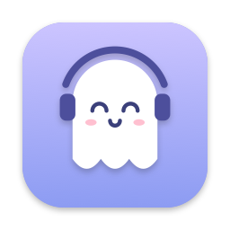

<p align="center">
  
</p>

# Meeting Buddy

Osobní macOS appka v menu baru. Pozná, že běží online meeting, po tvém potvrzení ho nahraje a pak ti v Obsidianu nechá poznámku se shrnutím, rozhodnutími, úkoly, klíčovými snímky sdílené obrazovky a celým přepisem.

Zpracování běží lokálně na Macu. Jediná služba mimo něj je Claude, který přes tvoje předplatné Claude Code čistí přepis a píše shrnutí. API klíč se nepoužívá.

## Co umí

- **Pozná meeting** v Microsoft Teams, Google Meet v Brave a v Discordu podle běžící appky, titulku okna a zvuku. Meeting nemusí být v popředí.
- **Nikdy nenahrává bez potvrzení:** notifikace „Nahrávat?“ (Ano / Ne), případně ruční start z menu.
- **Nahrává:**
  - zvuk jen meeting appky (`audio.m4a`), ne celého systému,
  - tvůj mikrofon jako samostatnou stopu (`mic.m4a`),
  - snímky okna meetingu, jen když se obsah změní a ustálí (slajdy, kód, dashboardy, ne kamery),
  - název a účastníky z Kalendáře.
- **Zpracuje na pozadí:**
  - rozlišení mluvčích (pyannote),
  - přepis Whisperem large-v3-turbo (čeština, slovenština a angličtina se poznávají po úsecích),
  - Claude přiřadí jména, opraví pojmy podle slovníku a napíše poznámku.
- **Poznámka v Obsidianu:** shrnutí, klíčové body, rozhodnutí, moje úkoly, úkoly ostatních, otevřené otázky, kde padlo moje jméno, sdílený obsah se snímky a celý přepis. Tvoje úkoly se navíc přidají do `Meetings/Moje úkoly.md`.
- **Okno appky:**
  - **Slovník** pojmů, které model komolí, s návrhy po každém meetingu,
  - **Přehled** nahrávek,
  - **Nastavení**,
  - **Úložiště** s úklidem starého audia a archivací poznámek.

## Jak to funguje

```
 Meeting Buddy (Swift, menu bar)                  Pipeline (Python, uv)
 ┌───────────────────────────────┐                ┌────────────────────────────────────┐
 │ detekce → „Nahrávat?“ → zvuk, │  recordings/…  │ diarizace → přepis → Claude:       │
 │ mikrofon, snímky, kalendář    │ ─────────────▶ │ jména, opravy, shrnutí → Obsidian  │
 │ stav v menu, notifikace       │ ◀───────────── │                                    │
 └───────────────────────────────┘  status.json   └────────────────────────────────────┘
```

Obě části si předávají soubory v `~/Library/Application Support/MeetingAssistant/`:

| Soubor | Obsah |
|---|---|
| `config.json` | nastavení (schéma `shared/config.schema.json`) |
| `vocabulary.json`, `vocabulary-suggestions.json` | slovník a návrhy do něj |
| `recordings/<datum>_<název>/` | `meta.json`, `audio.m4a`, `mic.m4a`, `frames/`, `transcript.json`, `status.json`, `pipeline.log` |

**Soukromí:**
- Zvuk, přepisy a snímky neopouštějí Mac.
- Hugging Face slouží jen ke stažení modelu, jeho telemetrie je vypnutá.
- Claude se volá jako `claude -p` bez API klíče a smí jen číst.
- Nahrávky ani přepisy se nikdy necommitují.

## Požadavky

- Mac s Apple Silicon a **macOS 26** nebo novějším.
- **Xcode 26+** (vyvíjeno v Xcode 27) a Homebrew.
- **Claude Code** přihlášený tvým účtem (`claude` → `/login`). Proměnná `ANTHROPIC_API_KEY` nesmí být nastavená.
- Účet na **Hugging Face** (zdarma), token typu *Read* a potvrzené podmínky modelu [pyannote/speaker-diarization-community-1](https://huggingface.co/pyannote/speaker-diarization-community-1).
- **Obsidian** s vaultem mimo iCloud.
- Volitelně macOS Kalendář s Google nebo Outlook účtem (Nastavení systému → Internetové účty).

## Instalace

1. **Nástroje:**
   ```sh
   brew install xcodegen uv ffmpeg gh
   sudo xcode-select -s /Applications/Xcode.app && sudo xcodebuild -license accept
   ```
2. **Repo:** kamkoli. Appka si pipeline najde ve složce, ze které byla sestavená (jde to změnit v Nastavení → Pokročilé).
   ```sh
   git clone https://github.com/mnovak99/meetBuddy.git
   cd meetBuddy
   ```
3. **Podpisový certifikát:** jednou na každém Macu. Stálý podpis zajistí, že macOS po každém buildu nezapomene udělená oprávnění. Skript se jednou zeptá na heslo k Macu.
   ```sh
   scripts/create-signing-identity.sh
   ```
4. **Pipeline:** modely (zhruba 2 GB) se stáhnou při prvním zpracování.
   ```sh
   cd pipeline && uv sync && cd ..
   ```
5. **Token Hugging Face** do Klíčenky. Příkaz se na token zeptá. Jde to i později v okně Nastavení.
   ```sh
   security add-generic-password -a "$USER" -s "MeetingAssistant HF token" -w
   ```
6. **Sestavení a instalace** do `/Applications`; skript appku rovnou spustí:
   ```sh
   scripts/install.sh
   ```
7. **Oprávnění při prvním spuštění:**

   | Oprávnění | Co udělat |
   |---|---|
   | Nahrávání obrazovky a systémového zvuku | povolit, pak v menu „Restartovat appku“ |
   | Notifikace | povolit; v Nastavení systému → Notifikace zvolit styl **Upozornění**, aby otázka nezmizela |
   | Kalendář | povolit |
   | Mikrofon | povolit |
   | Systémový zvuk | ptá se při prvním nahrávání |
   | složka Dokumenty | může se zeptat při prvním zápisu poznámky, pokud je tam vault |
8. **Nastavení:** v menu → **Otevřít Meeting Buddy…** → Nastavení vyber Obsidian vault (bez něj poznámky nevzniknou) a zapni **Spouštět po přihlášení**. Ostatní má rozumné výchozí hodnoty:
   - jméno = křestní jméno z účtu na Macu (podle něj Claude pozná tvoje úkoly),
   - mikrofon = výchozí vstup systému, nahrávání mikrofonu jde vypnout,
   - `uv` a pipeline se najdou samy.

### Instalace z release

Na [Releases](https://github.com/mnovak99/meetBuddy/releases) je `MeetingBuddy-X.Y.Z.zip`, ale je podepsaný jen lokální identitou autora (bez notarizace Apple), takže na jiném Macu ho Gatekeeper nepustí a oprávnění by se po aktualizaci ztrácela. **Na svém Macu si appku sestav ze zdrojáků podle kroků výše.** Release slouží hlavně jako přehled verzí.

## Používání

- **Duch v menu baru:**
  - bez tečky = čeká na meeting,
  - **oranžová** tečka = meeting detekován, čeká na odpověď,
  - **červená** = nahrává.
- **Průběh:**
  1. Začne meeting a přijde notifikace „Nahrávat?“ → **Ano**.
  2. Na konci **Ukončit** (z notifikace „Meeting pravděpodobně skončil“ nebo z menu).
  3. Pipeline poběží na pozadí, v menu je vidět průběh.
  4. Přijde notifikace **„Poznámka je hotová“**, kliknutím se otevře v Obsidianu.
- **Ruční nahrávání:** menu → Nahrávat ručně → Teams / Brave / Discord.
- Nahrávky kratší než 5 minut appka nabídne zahodit. Všechno mazání jde do Koše a vždy s potvrzením.

### Slovník

Slovník obsahuje jména kolegů a zákazníků, zkratky, produkty a termíny, které Whisper komolí. Funguje podle stejných pravidel jako „custom vocabulary“ profesionálních služeb pro přepis řeči:

| Pole | K čemu |
|---|---|
| **Správně** | jak se to má psát |
| **Typ** | zkratka, jméno, produkt, firma nebo termín |
| **Model píše** | chybné tvary z přepisů (oddělené čárkou) |
| **Význam** | rozvedení zkratky nebo role člověka; dostane ho jen Claude |
| **Do promptu** | Whisper ten pojem dostane předem. Jen pro vzácná slova, prompt má místo zhruba na 200 tokenů (ukazatel nahoře) |
| **Automaticky opravovat** | chybné tvary se nahradí hned po přepisu. Vypni, pokud je chybný tvar zároveň běžné slovo |

Po každém meetingu navrhne Claude pojmy, které Whisper nepoznal. Najdeš je nahoře ve Slovníku a vybereš **Přijmout**, **Upravit…** (třeba doplnit význam) nebo **Zamítnout** (zamítnuté se nevrátí). Slovník jde exportovat do CSV, upravit v Numbers nebo Excelu a importovat zpátky. Po úpravě slovníku dej u nahrávky v Přehledu **Přepsat znovu od začátku**.

## Vývoj

```
app/        Swift appka (project.yml pro XcodeGen, Sources/, Resources/, Tests/)
pipeline/   Python pipeline (uv; src/meeting_pipeline/, prompts/, tests/)
shared/     JSON schémata a ukázky (config, meta, status, vocabulary)
scripts/    install.sh, release.sh, create-signing-identity.sh, make-icons.sh
docs/       decisions.md (technická rozhodnutí a zjištění), původní SETUP a zadání
```

- **Projekt Xcode** se generuje z `app/project.yml` (`cd app && xcodegen generate`) a needituje se ručně.
- **Testy:**
  ```sh
  cd pipeline && uv run pytest && uv run ruff check     # Python
  uv run pytest -m slow -s                              # end-to-end se skutečnými modely
  xcodebuild -project app/MeetingAssistant.xcodeproj -scheme MeetingAssistant \
    -destination "platform=macOS,arch=arm64" test       # Swift
  ```
- **Logy:** v zsh je `log` vestavěný příkaz, proto plná cesta.
  ```sh
  /usr/bin/log stream --level debug --predicate 'subsystem == "dev.matej.MeetingAssistant"'
  ```
- **Ikona** se generuje kódem z `app/Sources/UI/GhostDrawing.swift`: `scripts/make-icons.sh`.
- **Pokyny pro Claude Code** jsou v `CLAUDE.md` a `.claude/skills/`.

## Vydání (Releases)

Vydává se jen z Macu autora, GitHub Actions se nepoužívají (podpisový klíč nikdy neopustí Mac a v repu nejsou žádná tajemství). Verze se řídí [SemVer](https://semver.org/lang/cs/) a změny se zapisují do [`CHANGELOG.md`](CHANGELOG.md):

1. Během práce doplňuj změny pod `## [Unreleased]`. Když tam nic není, poznámky se sestaví z commitů od posledního vydání.
2. Vydání:
   ```sh
   scripts/release.sh --bump patch   # 0.4.0 → 0.4.1; minor → 0.5.0, major → 1.0.0, nebo konkrétní verze 0.5.0
   scripts/release.sh --bump minor --draft   # jen koncept, zveřejníš ručně na stránce Releases
   ```
3. Skript:
   1. spustí testy,
   2. nastaví verzi v appce i pipeline a přejmenuje sekci v CHANGELOGu,
   3. vytvoří commit „Release 0.5.0“ a tag `v0.5.0`,
   4. sestaví podepsaný Release a zabalí ho do `MeetingBuddy-0.5.0.zip`,
   5. pushne a založí GitHub release s poznámkami z CHANGELOGu.
4. `scripts/release.sh --dry-run` jen otestuje a sestaví aktuální verzi, bez gitu a bez GitHubu.

## Řešení problémů

| Příznak | Řešení |
|---|---|
| Notifikace se nezobrazují | Nastavení systému → Notifikace → Meeting Buddy → povolit, styl „Upozornění“ |
| Nahrává se jen ticho | Nastavení systému → Soukromí a zabezpečení → Nahrávání obrazovky a systémového zvuku → povolit Meeting Buddy |
| Poznámka „bez rozlišení mluvčích“ | potvrď podmínky modelu pyannote na Hugging Face (odkaz výše), v Přehledu pak „Přepsat znovu od začátku“ |
| Poznámka „jen s přepisem“ | Claude nebyl dostupný (limit, odhlášení); appka to zkusí znovu po startu, nebo dej „Zkusit znovu“ |
| Zpracování selhalo | Přehled → pravým tlačítkem na nahrávku → Otevřít složku → `pipeline.log` |
| Po buildu se ztratila oprávnění | appka nebyla podepsaná identitou „MeetingAssistant Dev“ (`codesign -dv /Applications/MeetingBuddy.app`) |

## Stav

Hotové kroky 1–4: detekce, nahrávání, pipeline a GUI. Další je ladění podle ostrého provozu. Podrobnosti jsou v [`CHANGELOG.md`](CHANGELOG.md) a [`docs/decisions.md`](docs/decisions.md).

Je to osobní projekt: issues a pull requesty můžou zůstat bez odpovědi.

## Licence

[MIT](LICENSE) © 2026 Matěj Novák
